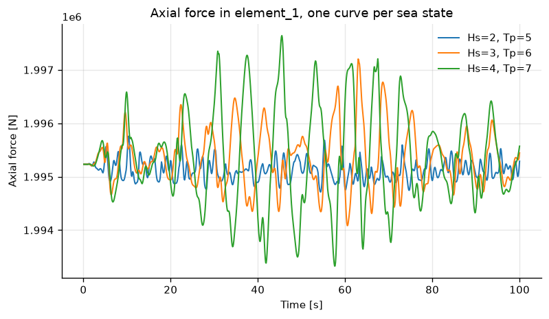
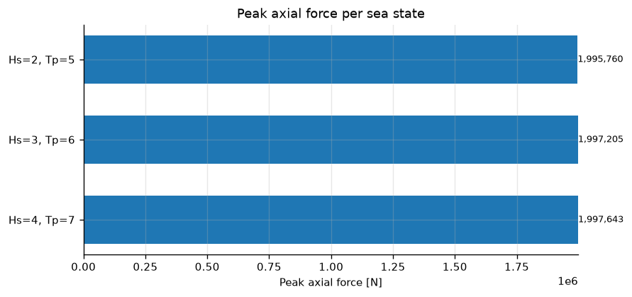

# Run Parallel Conditions

Runs one RIFLEX model three times over different sea states, concurrently, then
compares the results. The model is a simple beam under tension, and the three
runs vary significant wave height and peak period:

| case | Hs | Tp |
|---|---|---|
| `Hs=2.0_Tp=5.0` | 2.0 | 5.0 |
| `Hs=3.0_Tp=6.0` | 3.0 | 6.0 |
| `Hs=4.0_Tp=7.0` | 4.0 | 7.0 |

## Running it

Set `SRE_EXE` to a SIMA executable, then:

```bash
python riflex/run_parallel/run_parallel.py
```

It writes `summary.txt` and `plots/` under `output/run_parallel/`.

## Setting up the runs

Each case is one `run_condition` call. The same stask is imported every time and
the case's values override the task variables, so one model serves all three
runs:

```python
res = sima.run_condition(
    ws,
    stask=stask,
    task="SimpleBeam",
    condition="Initial",
    run_type="dynamic",
    variables={"Hs": 2.0, "Tp": 5.0},
    results_dir=result_folder,
)
```

Each case runs in its own working directory so the three do not collide.
`results_dir` copies the results out, which lets the working directory be
thrown away afterwards; leave it out and the results are read where they lie.

## Reading the results

Each case is post-processed on its own thread as soon as it finishes.

```python
def _process_single(res, case_name):
    signal = res.run.signal(f"{ELEMENT}/Axial force")
```

The runs finish out of order, so these lines appear out of order too:

```
   Hs=3, Tp=6         peak axial force      1,997,205 N
   Hs=4, Tp=7         peak axial force      1,997,643 N
   Hs=2, Tp=5         peak axial force      1,995,760 N
```

Once every case is done, a second pass compares them and prints statistics for
the axial force in element 1:

```
-- axial force in element_1 --------------------------------------------
   sea state                      min             max            mean           std
   Hs=2, Tp=5               1,994,714       1,995,760       1,995,126           179
   Hs=3, Tp=6               1,994,085       1,997,205       1,995,345           522
   Hs=4, Tp=7               1,993,327       1,997,643       1,995,364           886
   values in N, 1000 samples at dt=0.1 s
```

## Plots

The plotting helpers take signals rather than arrays, so every axis label is
`name [unit]` from the signal itself.



At this scale the curves sit on top of each other. The peaks differ by less
than 0.1 %, which a shared axis hides, hence the second figure.



```{eval-rst}
.. automodule:: examples.riflex.run_parallel.run_parallel
   :members:
   :undoc-members:
   :show-inheritance:
```

## Source Code

```{literalinclude} ../../riflex/run_parallel/run_parallel.py
:language: python
:linenos:
:caption: run_parallel.py
```

```{literalinclude} ../../riflex/run_parallel/utils/plotting.py
:language: python
:linenos:
:caption: utils/plotting.py
```
