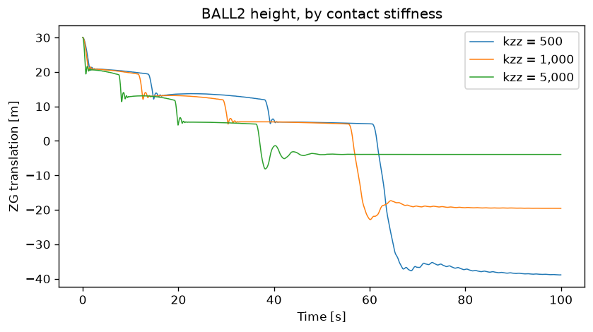
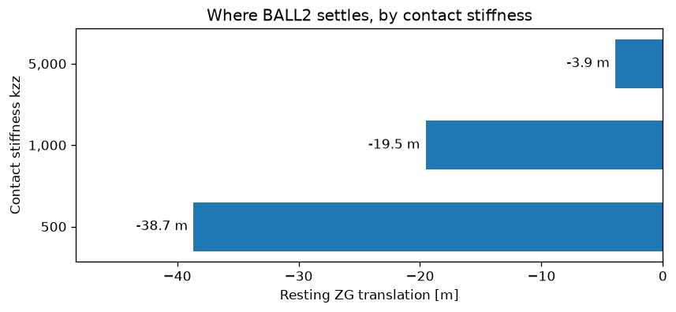

# Read SIMO Results

Compares the members of a SIMO condition set: reads the set back, tabulates
what changed and plots it.

The model drops two balls onto a stack of planes. The condition set runs it
three times with different values of `kzz`, the vertical stiffness of the
contact spring, so a softer spring lets a ball sink further into the plane it
lands on.

## Running it

```bash
python simo/run_simo_condition.py    # produces the results
python simo/read_simo_results.py     # reads them back
```

Needs `SRE_EXE` for the first script, and pandas and matplotlib for the second.

## Output

```
output\simo\condition\BouncingBalls\conditionSet
   3 members, kzz = 500, 1,000, 5,000

-- BALL2 height, 5,000 samples at dt=0.02 s --
              min        max       mean        std
kzz
500.0     -38.904     30.000     -6.252     23.984
1000.0    -22.834     30.000     -1.985     15.635
5000.0     -8.128     30.000      1.538      8.075

   wrote output\simo\condition\plots\ball2_height.png
   wrote output\simo\condition\plots\ball2_resting.png
```

## Reading a condition set

Opening the condition folder gives the set as SIMA's post processor shows it:
the set, then one condition per member. The example never names a run folder or
a result file:

```python
res = open_results(RESULTS)
members = [c for c in res.run.containers if c.type == "condition"]
```

If the condition has not been run yet, the example runs it first.

Each member holds the values it ran with, so it can label itself:

```python
member.signal("Variables/kzz").y[0]    # 500.0
```

## Summary statistics

`to_series()` gives a pandas Series indexed by time, so the statistics are one
call:

```python
series = member.signal(HEIGHT).to_series()
rows[kzz(member)] = series.describe()[["min", "max", "mean", "std"]]
```

Every ball is dropped from the same height, so `max` is 30.000 in every row
and confirms the runs are comparable. `min` is what responds: a soft spring
lets the ball through to −38.9 m, a stiff one stops it at −8.1 m.

## Plots

Height against time, one curve per member. The staircase is the ball coming to
rest on each plane in turn, and the softer the spring the further it eventually
falls:



Where it finally settles, taken as the mean of the last tenth of the run:



Axis labels come from `signal.unit` and `signal.xunit`.

```{eval-rst}
.. automodule:: examples.simo.read_simo_results
   :members:
   :undoc-members:
   :show-inheritance:
```

## Source Code

```{literalinclude} ../../simo/read_simo_results.py
:language: python
:linenos:
:caption: read_simo_results.py
```
