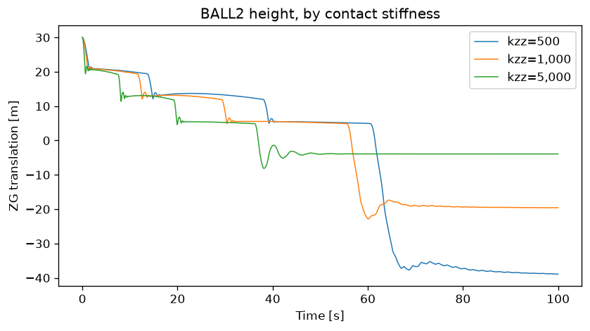

# Results as pandas

A signal becomes a Series, a container a DataFrame, and any signals sharing an
x-axis one frame. A frame has one x-axis, so it is normally one container.

The example reads what `run_simo_condition.py` produced: three runs of a
bouncing-ball model at different contact stiffness `kzz`. It runs the condition
first if those results are not there yet.

## Running it

```bash
python simo/results_to_pandas.py
```

Needs pandas and matplotlib, and `SRE_EXE` only if the condition still has to
be run.

## A signal is a Series

```python
series = member.signal(HEIGHT).to_series()
```

```
-- ZG translation as a Series ----------------------------------------
   index 'time', {'unit': 'm', 'xunit': 's'}
   first 0.1 s:  30.000, 29.997, 29.986, 29.970, 29.947, 29.918
   settles at:   -38.669 (mean of the last tenth)
```

The index is the signal's own x-axis, named `time` when it is in seconds, and
the units travel with it in `attrs`. Everything pandas does to a Series works
from there: `series.loc[0.0:0.1]` is a time window, not a row range.

## A container is a DataFrame

One container is one source block, so its signals share an x-axis and line up
as columns:

```python
frame = member.container(POSITION).to_dataframe()
```

```
-- Dynamic/BALL2/Global total position as a DataFrame --------------------
   6 columns on a 'time' index
                    count       mean        std        min        25%        50%        75%        max
XG translation   5000.000     95.770     93.485     -0.007     24.262     47.145    194.677    267.092
YG translation   5000.000      5.000      0.000      5.000      5.000      5.000      5.000      5.000
ZG translation   5000.000     -6.252     23.984    -38.904    -36.731      5.330     13.448     30.000
XB rotation      5000.000    -64.908    106.647   -180.000   -180.000      0.000      0.000    180.000
YB rotation      5000.000      4.489     50.140    -89.954    -36.309      6.449     46.311     89.950
ZG rotation      5000.000     59.868    109.556   -180.000     -0.000      0.000    180.000    180.000
```

Three columns are translations in metres and three are rotations in degrees.
A DataFrame has no unit per column, so the frame carries them in `attrs`:

```python
frame.attrs["units"]
# {'XG translation': 'm', ..., 'XB rotation': 'deg', ...}
```

## Why one container

Framing a whole member would align signals that do not share an axis, which means
inventing values, so it is refused:

```python
member.to_dataframe(recursive=True)
```

```
'kzz' and 'XG translation' do not share an x-axis (1 vs 5000 samples). Frame each container separately.
```

Here it is the member's own `kzz` variable, which is a single sample, against
5000-sample results. `recursive=True` is worth using when a subtree really does
share one axis; it just cannot be assumed.

## One column per member

The three runs are the same model at different stiffness, so they share an
axis and go in one frame. `names=` labels the columns, and the units follow:

```python
frame = signals_to_frame(heights, names=[f"kzz={kzz(m):,.0f}" for m in members])
```

```
               count       mean        std        min        25%        50%        75%        max
kzz=500     5000.000     -6.252     23.984    -38.904    -36.731      5.330     13.448     30.000
kzz=1,000   5000.000     -1.985     15.635    -22.834    -19.316      5.185     12.613     30.000
kzz=5,000   5000.000      1.538      8.075     -8.128     -3.924     -3.910      5.417     30.000

   correlation between members
           kzz=500  kzz=1,000  kzz=5,000
kzz=500      1.000      0.918      0.673
kzz=1,000    0.918      1.000      0.781
kzz=5,000    0.673      0.781      1.000
```

`max` is 30.000 in every row because every ball is dropped from the same
height, which confirms the runs are comparable. The correlation falls off with
the stiffness gap: the two soft springs track each other at 0.918, the softest
and stiffest only at 0.673.

## Plotting from the frame

`frame.plot()` takes the legend from the columns and the x-axis from the index,
and the units come from `attrs`:

```python
axes = frame.plot(figsize=(8, 4), linewidth=0.9)
axes.set_xlabel(f"Time [{frame.attrs['xunit']}]")
axes.set_ylabel(f"{quantity} [{frame.attrs['units'][frame.columns[0]]}]")
```



The staircase is the ball coming to rest on each plane in turn, and the softer
the spring the further it eventually falls.

```{eval-rst}
.. automodule:: examples.simo.results_to_pandas
   :members:
   :undoc-members:
   :show-inheritance:
```

## Source Code

```{literalinclude} ../../simo/results_to_pandas.py
:language: python
:linenos:
:caption: results_to_pandas.py
```
